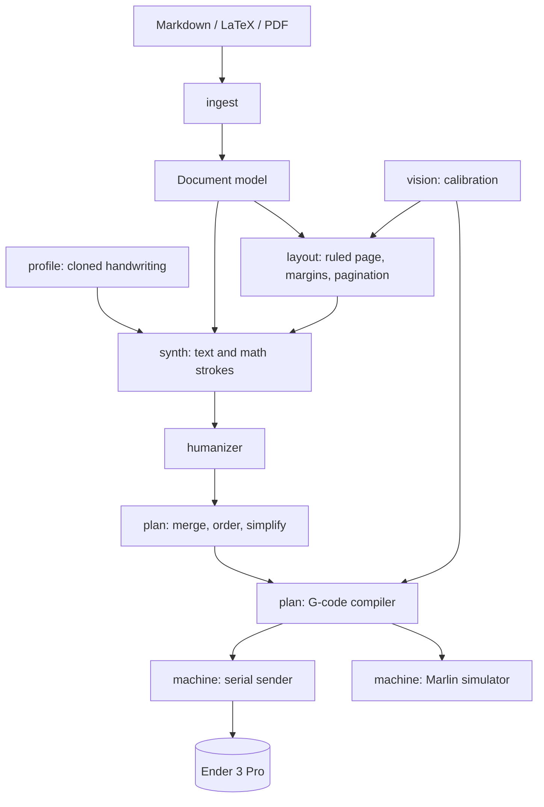

# Architecture (target, pending ADRs)

Decisions are made by research cards and recorded as ADRs in `adr/`. Until ADRs 0001-0005 are accepted, module names below are provisional.

## Module zones

| Module | Responsibility | Zone |
|---|---|---|
| `core` | Stroke/Path/Page types, transforms, serialisation | core |
| `profile`, `synth` | Handwriting cloning, text and math stroke synthesis, humanizer | profile |
| `ingest`, `layout` | Documents in, pages out | ingest |
| `plan`, `machine` | Optimisation, G-code, sender, simulator | plan |
| `vision` | Paper/border detection, calibration | vision |
| `api`, `web` | Local FastAPI server and UI | api |

## Cross-cutting design rules

- Units are millimetres everywhere internally; conversion happens at the machine boundary.
- All inter-module data are typed, versioned, JSON-serialisable (`schema_version`).
- Heavy engines (OCR, PDF converters, TeX layout) are isolated behind subprocess or loopback boundaries with timeouts, memory limits and clear errors.
- Every plugin that can touch the network is off by default and covered by a zero-egress test.
- Failure never produces silent wrong output: low confidence or missing data yields an explicit error/warning, with a documented fallback.
