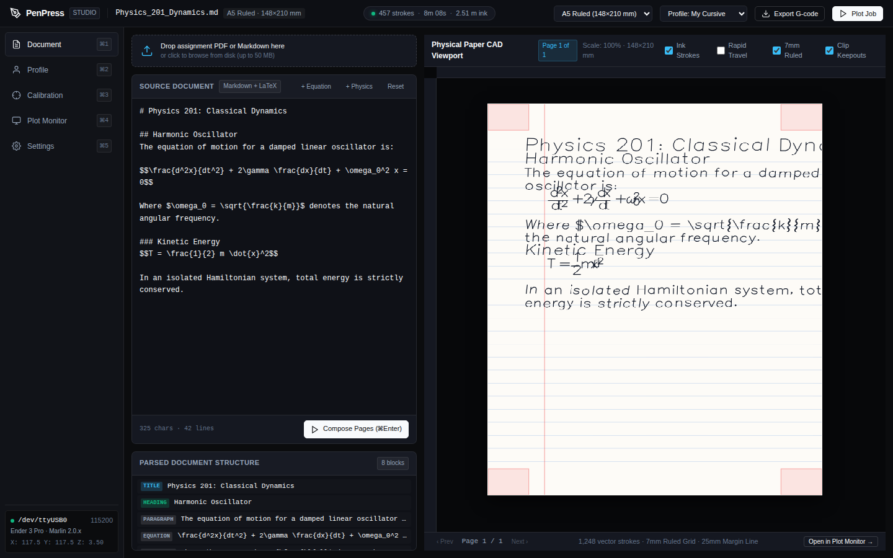

# PenPress Quickstart & User Guide

**PenPress** converts assignments, mathematical notes, and structured documents into authentic personalized handwriting toolpaths executed on an Ender 3 Pro 3D printer equipped with a spring-loaded pen mount.

---

## 1. System Requirements & Hardware Setup

### Hardware Components
1. **Ender 3 Pro 3D Printer** (running Marlin firmware, 220x220 mm bed).
2. **Spring-Loaded Pen Mount**:
   - Mounts to the Ender 3 Pro X-carriage using standard M3 screw holes (heaters and fans remain disconnected/cold).
   - Features 1.5–2.0 mm of spring travel to absorb bed height variations and prevent gouging paper.
3. **Writing Utensils**:
   - Gel pens (0.5 mm or 0.7 mm, e.g. Pilot G2, Uni-ball Signo, or fountain pens).
4. **Paper Fixturing**:
   - Standard paper clips or low-profile binder clips securing paper to the bed.
   - Recommended paper formats: **A5** (single orientation) or **A4** (dual-pass or portrait).

### Software Requirements
- Standalone single-binary executable (`penpress` / `penpress.exe`), or Python 3.11+ / uv.
- Works 100% offline with zero network egress.

---

## 2. Fast-Track Quickstart

### Launching PenPress Studio
Run the standalone binary or CLI:
```bash
penpress serve --host 127.0.0.1 --port 8080
```
Open your browser to `http://127.0.0.1:8080`.



### Quick Workflow (3-Step Plotting)
1. **Document Ingest**: Drop in Markdown, LaTeX, or PDF files. PenPress extracts headings, text, mathematical formulas, and vector diagrams into continuous single-stroke paths.
2. **Preview & Toolpath Telemetry**: Inspect the simulated pen strokes, pen lift counts, and estimated print duration in real time.
3. **Stream or Export**: Stream directly over USB serial with Marlin checksum flow control and automatic recovery, or export safe `.gcode` to an SD card.

---

## 3. Dual-Mode Calibration Wizard

PenPress features a dual-mode bed calibration wizard ensuring perfect pen contact across the entire page:

### Mode A: Computer Vision Camera Alignment
- Position a USB webcam or smartphone camera overlooking the bed.
- Click **"Detect Corners with Camera"**.
- Subpixel corner refinement accurately detects paper boundaries and generates keepout zones for corner clips with 5 mm clearance.

### Mode B: 4-Step Tactile Jog & Paper Drag Alignment
If camera lighting is poor or no camera is attached, the tactile wizard provides guided positioning:
1. **Origin Point**: Jog pen to bottom-left corner of the paper sheet.
2. **Width Point**: Jog pen along X-axis to bottom-right corner.
3. **Height Point**: Jog pen along Y-axis to top-left corner.
4. **Z-Touch (Paper Drag Test)**: Lower Z in 0.1 mm increments until a sheet of paper placed under the pen tip encounters gentle friction.


---

## 4. CUPS Virtual Print Driver Setup (Linux & macOS)

PenPress can function as a virtual system printer, allowing direct printing from LibreOffice, Google Docs, or Microsoft Word.

### Installation
1. Copy the backend script to the CUPS backend directory:
   ```bash
   sudo cp packaging/cups/penpress-print /usr/lib/cups/backend/penpress-print
   sudo chmod 700 /usr/lib/cups/backend/penpress-print
   ```
2. Add the printer queue via `lpadmin`:
   ```bash
   lpadmin -p PenPress_Plotter -E -v direct://penpress-print -m raw
   ```
3. In any desktop application, select **Print** and choose **PenPress_Plotter**. The document will automatically spool into `~/.penpress/spool/` for immediate plotting.

---

## 5. Linux Background Service (systemd)

To run PenPress continuously in the background on your workstation or VPS:
```bash
mkdir -p ~/.config/systemd/user
cp packaging/systemd/penpress.service ~/.config/systemd/user/
systemctl --user daemon-reload
systemctl --user enable --now penpress.service
```

Verify service status:
```bash
systemctl --user status penpress.service
```
